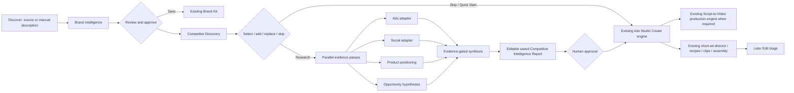

# Vergeye Ads Studio — Phase 0–3 architecture audit

Version: 3.0 · 21 October 2026  
Scope: Phase 0 + Phase 1 + Phase 2 Creative Intelligence + Phase 3 Script-to-Video integration · Draft, not published  
Capability registry: `lib/videoEngines.ts` → `VIDEO_CAPABILITY_REGISTRY_VERSION = "2026-10-21.phase3"`; production detail → `VERGEYE_CAPABILITY_REGISTRY_VERSION = "vergeye.video-capabilities.2026-10-21.v1"`

## Executive decision

There were two registered products doing adjacent work: `phantom` (Vergeye research/comparison/video) and `ads-studio` (the mature eight-step ad engine). The least disruptive architecture is to keep the `ads-studio` id and its existing production code, make the former Vergeye screens its Discover/Research entry point, and remove the duplicate `phantom` registration. The former `apps/Phantom/` files remain an unregistered implementation library; they are not a second product.

Vergeye is the research, intelligence, strategy and campaign-orchestration layer. It does not become a renderer. Phase 3 sends every Vergeye video—short or long—into the existing Script-to-Video five-stage engine. The older Ads Studio clip implementation remains intact source code for compatibility, but Vergeye navigation and CreativeBriefs no longer open it as a second project store, queue, storyboard or editor.

## 1. Current Architecture Review

### Script-to-Video: five production stages

The active flow in `apps/ScriptToVideo/` maps to the requested five-stage model:

1. **Brief** — `CreateFlow.tsx` accepts an idea or the customer’s own script. AI changes are proposals and require acceptance. Type, style, storyboard, duration, orientation and model are collected before planning.
2. **Cast & Look** — `pipeline/opus.ts` analyses the entire accepted script; `pipeline/orchestrator.ts` creates recurring-character sheets. Narration-only roles are not turned into visible cast. Sheets are editable and require approval.
3. **Plan** — the planner decomposes the accepted script into legal model blocks, writes timed prompts and persists the optional storyboard. Each block carries exact script coverage, visual goal, cast/look references, continuity requirements and negative constraints.
4. **Produce** — `stv-scene-generate` starts authenticated work; `s2v-recovery-sweeper` leases, resumes, submits and polls blocks, extracts continuity frames and handles fallbacks without requiring an open browser.
5. **Finish** — `RenderRoom.tsx`, `AssemblyBar.tsx` and `ReviewFinish.tsx` support block review/regeneration, stitching, captions/audio options, library persistence and final export. Gemini Omni edits are true source-video edits and preserve Before/After/Accept/Undo.

### Scene/script parsing and storyboard

- Canonical accepted script is preserved; planning derives blocks rather than silently rewriting source.
- `manualScript.ts` handles idea/own-script proposal flows.
- `pipeline/opus.ts` owns script-level segmentation and cast analysis.
- `pipeline/orchestrator.ts` owns legal duration packing, dependent blocks, cast identity locks and storyboard records.
- Storyboards are block-level views over the production plan, not a second rendering pipeline.

### Image generation

- `asset-image-gen` is the focused Gemini 3.1 Flash Image service used for durable character sheets and still assets. It validates actual image output, rehosts data URLs and returns HTTPS assets.
- `vv-image-generate` is the wider shared image router: platform-managed GPT Image, explicit GPT Image 2, DALL·E 3 with disclosed fallback, and Gemini 3.1 Flash Image. It records model used and fallback provenance.
- Both services deliberately omit the invalid browser-shaped `X-App-Id` on the Veo image proxy.
- Phase 1 reuses existing brand/site logo URLs; it does not generate logos or fabricate source assets.

### Video integrations and routing

`lib/videoEngines.ts` is the only client-side capability registry. `lib/videoEngineClient.ts` is the shared network/error layer. `components/EngineSelector.tsx` is the shared picker. Shot intent routes through `routeShotIntent()`; new Vergeye phases must extend these modules rather than add another provider catalog.

- Seedance 2.5 routes through the unified image/video generation proxy.
- Kling routes through the Kling proxy and is separately authenticated for unattended S2V work.
- Gemini Omni 1.1 Flash is the consistency/edit fallback and supports actual `videoData` editing.
- Runway recipes remain in Ads Studio and are quote-first.

### Durable queues and server-side polling

The workspace’s established pattern is: project/state row → one server function advances bounded work → lease/idempotency key → self-invoke continuation → consolidated orphan sweep → browser observes status.

Relevant implementations:

- `ads-studio-worker` adopts Group A clip operations into `ads_clip_jobs`. A completed row is still uninspected footage; browser-side director inspection remains mandatory.
- `stv-scene-generate` validates owned films/cast approval and starts S2V.
- `s2v-recovery-sweeper` resumes dependent blocks, extracts frames, stitches and emits a deduplicated completion notification.
- `vidverge-orchestrator` supplies the consolidated recovery beat instead of each worker creating private schedules.

### Editor and timeline

Ads Studio currently uses per-clip review cards, GSAP/SVG overlays and browser FFmpeg assembly rather than a general NLE. Script-to-Video has independent block regeneration and a production board. Video Enhancer is the general timeline/editor. Phase 1 must hand approved context into an engine; it must not create another timeline.

### Asset storage and project persistence

- S2V current tables include `s2v_films`, `s2v_film_scenes`, `s2v_asset_registry`, `s2v_characters`, `s2v_events`, `s2v_references` and legacy `s2v_projects`/`s2v_scenes`/`stv_projects`.
- Ads Studio durable provider operations use `ads_clip_jobs`; the production session still uses local storage for rich in-browser state.
- Research persistence already exists in server-hooks-only `vergeye_comparisons`, which stores brand, competitors, matrix, insights, script/render history and handoff metadata. Phase 1 embeds evidence/report/approval inside `insights_json` to avoid a premature table family.
- Brand Kit persistence uses `brand_context_settings`; an approved Brand Profile is written as human-reviewed brand context for reuse by all studios.
- Generated assets use durable platform storage URLs; provider base64 responses are rehosted before persistence.

### Product Launch

`apps/ProductLaunch/` is a separate code-first launch-film engine: URL extraction → competing FilmSpecs → deterministic component plan → TSX compile gate → Remotion render → frame QA → critic → bounded targeted iteration. Later Vergeye “SaaS Launch” strategy should hand a structured launch brief to this existing engine, never clone it.

### Existing agent infrastructure

- Customer-facing routing lives in `agent/customer-prompt.md`.
- Workspace chat uses `AgentChatView`, `AgentChat`, and `useAgentChatRuntime`.
- Per-workflow agent code already exists in Ads Studio (`opus.ts`), S2V (`pipeline/opus.ts`) and Product Launch prompts/pipeline.
- Phase 1 uses narrow research roles with structured findings. Deterministic code owns source availability, evidence labels, cache keys, approval gates and stage transitions.

### Credits and billing

`vv_credit_accounts` and `vv_credit_ledger` are authoritative billing tables and were not modified. Production charges use stable operation keys through `vv-credits`; terminal failures use idempotent refund keys. `trackb_credit_events` exists for Track B. Phase 1 performs no image/video generation and shows that research uses workspace search/LLM allowance. Later paid operations must show an estimate before submission and record category (`research`, `llm_planning`, `image`, `video`, `editing`, `rendering`) without allowing browser code to set authoritative money/status fields.

### Auth and permissions

- `vergeye_comparisons` is `serverHooksOnly`, scoped by `owner_key`, and written only through `vergeye-ops`.
- `stv-scene-generate` uses `workspace_session` and validates film ownership.
- `asset-image-gen` and `vv-image-generate` use validated workspace sessions.
- Browser workspace tokens are public integration credentials, not secrets; trust-sensitive writes stay in server functions.
- The Kling unattended path resolves only the named owner secret and never stores/logs its value.

### Reusable UI and current Ads Studio / Brand Kit

- Shared shell: `AppShell`, design-system components, shared theme tokens and responsive Desktop sidebar.
- Existing Ads Studio: eight-step direct-response flow, Runway Recipes, director inspection, clip regeneration, overlays, assembly and variations.
- Existing Vergeye research UI: brand profile, competitor cards, editable comparison, saved reports and export.
- Brand Kit: `brandContextStore.ts` + `BrandContextLayer.tsx` + `brand_context_settings`.

## 2. Gap Analysis

| Requirement | Current state after Phase 1 | Remaining gap / least disruptive fix |
|---|---|---|
| One Vergeye Ads Studio product | Implemented: one `ads-studio` registration; duplicate `phantom` registration removed | Move unregistered research files into `apps/AdsStudio/` only during a later low-risk cleanup; no behavior depends on the old app id now |
| Discover → Research → Strategize → Create → Edit | Implemented navigation; Strategize is the Phase 2 Creative Intelligence surface; Create uses existing Ads Studio/Product Launch/Script-to-Video routes; Edit opens Video Enhancer | Phase 3 adds image/marketing production behind the emitted CreativeBrief contracts |
| Flexible brand input | URL/social URL/company/manual text accepted; URL path invokes real extraction; manual input becomes clearly inferred/editable | Dedicated authorised social/channel adapters are later work |
| Verified vs inferred | Implemented labels and source URL treatment | Existing `vergeye-ops` extraction is profile-level, not field-level evidence; later add field evidence in the server response |
| Save approved Brand Profile | Implemented through existing Brand Kit store | A future structured Brand Kit schema can replace the current prompt-text representation without changing the approval action |
| Real competitor discovery | Existing Google search + official-site analysis; cards have source URL, score, select/remove/add | “Replace” is remove + add URL; a dedicated one-click replace control is optional polish |
| Top five default, no hard limit | Implemented: first five selected/recommended; more candidates remain visible | None |
| Parallel deep research | Independent evidence passes run together and visible role states are persisted | Current deep pass is deterministic over already-collected official-site profiles. Authorised Meta/TikTok/LinkedIn/Reddit/Product Hunt adapters are unavailable in this run and are recorded unavailable. Do not imply those sources were searched |
| Evidence and confidence | Implemented per finding with URL/date/evidence/confidence/type | Field-level quote/snippet offsets require a server contract extension |
| Dashboard, filter, saved/cache, refresh, export, approval | Implemented on the existing comparison/report row | PNG export remains client-side; structured JSON/CSV export is later work |
| Durable backend research jobs | Autosave/report durability exists; expensive provider work already uses workers | Long-running multi-source research still needs a dedicated leased server worker before adding paid Apify actors |
| One production engine | Implemented in Phase 3: every Vergeye video brief and Quick Start opens Script-to-Video | SaaS Launch reuses Product Launch components inside S2V; legacy Ads renderer remains unreachable from Vergeye |

Primary conflict found: the brief asked to rename/merge Ads Studio, but the workspace already had a separate registered Vergeye app with its own video route. Keeping both would violate the one-product/one-engine principle. The least disruptive fix is the merge performed here: reuse its research UI/back end as an unregistered module, remove its product registration, and route Create to the existing Ads Studio engine.

## 3. Agent Architecture

| Role | Minimal input | Structured output | Dependencies |
|---|---|---|---|
| Brand Intelligence | User-provided source/description; fetched public pages only | Editable Brand Profile; source status; URL; observed identity/offering/audience/positioning/pricing/visual assets; inferred fields labelled | `vergeye-ops`, web fetch/search, Brand Kit save |
| Competitor Discovery | Approved brand name/category/url | Real candidate cards with official URL, why relevant, relevance score, source and selected state | `/api/search`, official-site analyser |
| Agent A — Ads | Selected competitor ids + authorised ad-source result only | Hook/message/offer/CTA/format/landing URL findings | Adapter availability gate; unavailable in this run |
| Agent B — Social | Selected competitor ids + authorised public social result only | Themes/formats/cadence/response observations; never conversion claims | Adapter availability gate; unavailable in this run |
| Agent C — Product | Selected official-site profiles | Features, public pricing, differentiators, objections, strengths/weaknesses | Existing profiles |
| Agent D — Opportunities | Verified findings only | Gaps, overused angles, differentiated hooks; hypotheses labelled | A/B/C output |
| Agent E — Synthesis | A–D findings and evidence | Deduplicated report; unsupported claims dropped; comparison and strategic summary | Deterministic evidence gate + interactive/background LLM where configured |

Every finding contract is `{ id, agent, competitorId, category, claim, evidence, sourceUrl, observedAt, confidence, evidenceType }`. Agents receive only the selected profiles and source slices they require. Code, not a model, controls availability, status, idempotency, cache keys and approval.

## 4. Workflow Diagram

## 5. Model Integration Plan

Verified against the actual platform integration contracts on 21 October 2026 and recorded in the canonical registry version above:

| Model | Real app/API id | Duration | Resolution / ratios | Audio | References / edit | Routing rule |
|---|---|---|---|---|---|---|
| Seedance 2.5 | `openrouter/bytedance/seedance-2.5` | Every integer 4–30s | 480p/720p; 16:9, 4:3, 1:1, 3:4, 9:16, 21:9 | Optional | First frame; first+last; OR 1–3 asset refs. Refs cannot combine with frames. No source-video edit | Prefer fewer long cinematic blocks; never hardcode 30s chunks when script coverage needs another legal length |
| Kling Omni 3.0 | `kling-3.0-omni` → provider `kling-v3-omni` | 5 or 10s only (not 15s) | std 720p / pro 1080p; 16:9, 9:16, 1:1 | Silent | Text, first/last, or 2–4 refs. No video refs/edit | Prefer recurring people/dialogue where silent clip production is acceptable; show actual model fallback |
| Gemini Omni 1.1 Flash | `gemini-omni-1.1-flash` | Up to 8s | 720p; 16:9/9:16 | Optional | Seed + up to 10 refs; first+last; actual `videoData` edit | Consistency and clip-edit engine; use for legal fallback blocks and explicit edits |

Do not hardcode broader provider marketing claims. The proxy contract is authoritative. Never silently truncate a requested duration: decompose it into legal dependent blocks and preserve total runtime. Kling’s present proxy does not expose 15-second blocks. Omni edits cap at 8 seconds. Paid generation remains behind estimates, stable operation keys and actual-result provenance.

## 6. Script-to-Video Reuse Plan

Reuse unchanged:

- accepted-script contract and immutable source wording;
- cast/identity approval and Brand Kit look context;
- duration packing from the central model registry;
- storyboard/block plan and independent block regeneration;
- server-side submit/poll/recovery/frame extraction/stitching;
- Omni Before/After/Accept/Undo editing;
- library/project persistence and completion notification.

Extensions later:

- define one `VergeyeCreativeHandoff` with `brandProfile`, `approvedFindings`, `selectedAngle`, `script`, `storyboard`, `brandKitRef`, `style`, `targetPlatforms`, `duration`, `aspectRatio`, `claimsRequiringReview` and evidence ids;
- map short-form styles to S2V configuration, not forks;
- store source finding ids on claims/scenes for review;
- route Product Launch concepts to the existing Product Launch engine;
- use per-scene regeneration only.

## 7. UI/UX Screen Plan

### Built in Phase 1

- **Discover** — flexible source/description intake, cost note, Quick Start, editable profile, verified/inferred legend, approve/save Brand Kit.
- **Research: competitor selection** — real source cards, top-five recommendation, relevance score, include/exclude/remove/add URL, unavailable states, skip.
- **Research: report** — five agent-role statuses, 10-row comparison, strategic summary, evidence search/filter, source links, confidence/date/type, unavailable-source list, saved/cache timestamp, refresh, PNG export and approval gate.
- **Saved reports** — existing per-owner history and resume.
- **Strategize** — approved-profile gate, optional approved research, ranked/editable/regenerable/combinable/custom angles, simultaneous Content Type Selection, cost preview and persisted CreativeBrief handoffs.
- **Create** — existing Ads Studio production workflow, unchanged, with a back-to-intelligence control; SaaS Launch routes to Product Launch and long-form cinematic/explainer/motion routes to Script-to-Video.
- **Edit** — routes to the existing Video Enhancer rather than creating another timeline.

Responsive behavior uses the existing Vidverge amber/charcoal system, 44px controls, horizontally scrollable stage rail and one-column mobile fallbacks. Empty/error/partial/unavailable states name a recovery action and do not expose agent debugging.

Whole-experience check: `Desktop.tsx`, `AgentChatView.tsx`, `Settings.tsx` and `EmailGate.tsx` were reviewed. Desktop navigation and the signed-out Email Gate were updated to show one Vergeye Ads Studio product; the Email Gate version marker was preserved and incremented to 117. Agent chat already used an on-brand competitor-comparison starter and app-id routing, and Settings had no duplicate studio naming, so neither needed a visual rewrite.

## 8. Backend Plan

### Phase 1 reuse

- `vergeye-ops`: server-side URL reads, search, model analysis and server-hooks-only project writes.
- `vergeye_comparisons`: durable autosave, cache/report/approval payload in `insights_json`.
- `brand_context_settings`: approved Brand Profile handoff.
- `ads-studio-worker` and `ads_clip_jobs`: durable paid clip polling.
- S2V worker/table family for long-form production.

### Later additive contracts (design only; not created in this task)

Create new `vg_` tables only when the existing comparison row becomes a measured bottleneck:

- `vg_campaigns`: owner, name, approved report id, strategy JSON, production project id/status.
- `vg_research_sources`: campaign/report, source kind/url, observed_at, availability, adapter/version, content fingerprint, cache expiry.
- `vg_research_findings`: source id, agent/category, claim/evidence/confidence/type, approval and supersession state.
- `vg_cost_events`: stable operation key, category, provider/model, estimate, actual cost reference and status; authoritative fields server-only.

If introduced, writes should be server-function-only with owner/session validation. A research worker should lease one adapter unit, use bounded concurrency, honour Retry-After, timeout and retry only free/idempotent reads, and never automatically retry uncertain paid operations. CAPTCHA/login/rate-limit/access-control failures become `unavailable`, not bypass attempts.

Later phase data contracts:

- `CreativeAngle`: id, type, conceptName, objective, audience, hook, message, style, cta, duration, platforms, rationale, evidenceIds, complexity, namedCompetitorClaimReview.
- `ProductionPlan`: engine=`script-to-video`, mode=`automatic|manual|hybrid`, scenes, legal model blocks, routing reasons, brand refs, claim review, cost estimate.
- `ImageAdPlan`: exact composed text layers separate from generated background imagery.
- `CampaignAssetPack`: approved strategy, asset manifests, source provenance, platform/crop variants and QA state.

## 9. Prioritised Task Breakdown

1. **P0 complete** — one registration/product, existing production preserved, central registry versioned.
2. **P0 complete** — flexible brand intake, editable profile, Brand Kit approval.
3. **P0 complete** — sourced competitor cards, default top five, selection/add/skip.
4. **P0 complete with documented source limits** — parallel structured evidence passes, synthesis, evidence dashboard, approval, save/cache/refresh/export.
5. **P1 next** — move deep research to a leased backend worker before enabling paid Apify adapters; add field-level quote evidence.
6. **P1 complete in Phase 2** — server-side Creative Strategy Agent, deterministic output validation, ranked/editable angle UI and optional competitor context.
7. **P2 complete** — persisted `CreativeBrief` handoffs into Ads Studio, Script-to-Video and Product Launch with claim-review and image-text policies.
8. **P3 video complete** — all video styles emit structured Script-to-Video handoffs; shared capability routing, editable plans, approval, async recovery and per-scene regeneration are wired. Image-ad and marketing-content production remain later scope.
9. **P4 dependency** — asset packs, image composition, SEO/AEO production and Omni edit surface.
10. **P5** — provider fixture matrix, accessibility, load/concurrency, billing reconciliation and recovery drills.

The canonical Phase 2 and Phase 3–5 contracts plus QA evidence are in `apps/AdsStudio/CREATIVE_INTELLIGENCE.md`.

## 10. Testing, Acceptance and Rollback

### Completed in this draft

- Audos syntax/schema safety gates accepted every file/config write.
- App registry now contains one merged `ads-studio` product named Vergeye Ads Studio; `phantom` is no longer registered.
- Existing Ads Studio source was preserved and is reachable from Create/Quick Start.
- Brand intake accepts a URL or manual description; URL extraction uses the existing real server path; manual input is marked inferred.
- Brand Profile remains editable and can be approved into the existing Brand Kit.
- Competitor discovery remains real-search/official-site based; top-five/select/add/remove/skip controls are present.
- Deep report retains source URL/date/evidence/confidence/type, exposes filters and approval, autosaves in the existing report row, and supports refresh/export.
- Existing S2V, Ads Studio workers, billing tables and production tables were not modified.

### Source status in this run

- **Contracts and existing implementation verified:** Google web search, official-site fetch/analysis, saved report backend and Brand Kit persistence.
- **Live probe result:** a direct `brand.analyze` execution for `https://stripe.com` returned `401 Workspace session required` in 98ms because this build-agent execution had no validated customer session. That confirms the auth gate; it does not prove an authenticated Preview run. No data was written.
- **Configured but not live-spend tested here:** Apify web scraping. It is not enabled in Phase 1 because actor selection/cost/rate limits need the backend worker and explicit estimate.
- **Unavailable/not executed and reported honestly in the UI:** Meta Ad Library, Facebook/Instagram public feeds, LinkedIn company feeds, TikTok creative, Reddit, Product Hunt and Google Ads Transparency. No claims from those sources were invented.
- **Model contracts verified from platform catalog, not paid generation:** Seedance 2.5, Kling Omni 3.0, Gemini Omni 1.1 Flash.

### Not tested

- No publish or authenticated live-browser test was performed; this task must remain a draft. The unauthenticated real-URL probe stopped at the expected workspace-session gate.
- No paid search actor, LLM batch, image generation, video generation, render, credit debit/refund or billing-table mutation was executed.
- No CAPTCHA/login/rate-limit bypass was attempted.
- Existing production engine regression is source-preservation and compile-gate level only; a paid end-to-end ad/S2V render was not run.

### Acceptance checks for founder review

1. Open Vergeye Ads Studio and confirm Discover is first.
2. Paste a real website URL; review/edit VERIFIED vs AI-INFERRED profile; approve to Brand Kit.
3. Confirm real competitor URLs, top-five defaults, include/exclude/remove/add and skip.
4. Run Research; inspect agent states, unavailable-source disclosure, evidence links and hypotheses.
5. Edit a comparison cell, filter evidence, approve the report, refresh and reopen it from Saved.
6. Enter Create and confirm the original Ads Studio workflow/Recipes still work; return to research.
7. Open Script-to-Video separately and confirm its existing five-stage workflow is unchanged.

### Rollback

No destructive schema change was made. Roll back by restoring the pre-task snapshot if available, or revert the listed draft files. Database rows and billing tables require no rollback. If a saved Phase 1 report is unwanted, the existing Saved report remove action uses `vergeye-ops`; no table deletion is required.
